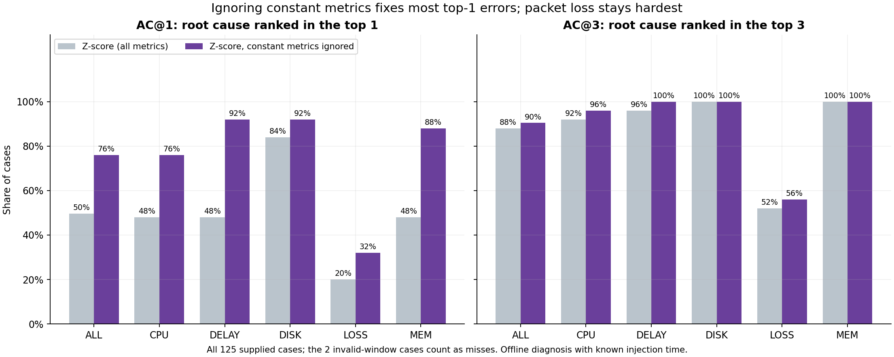
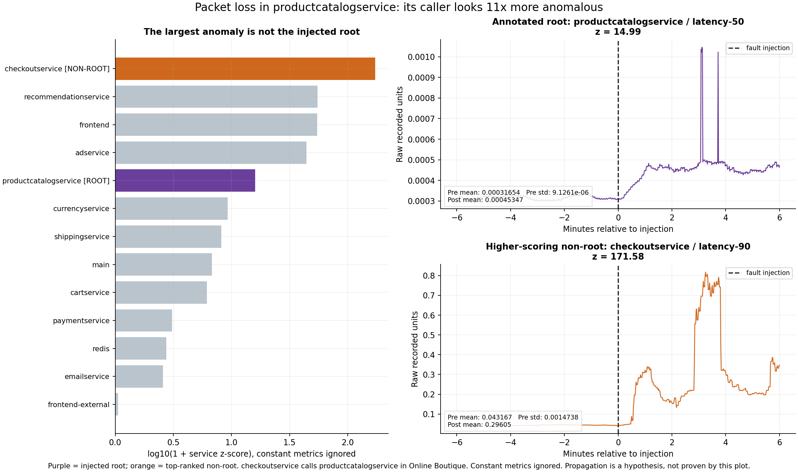
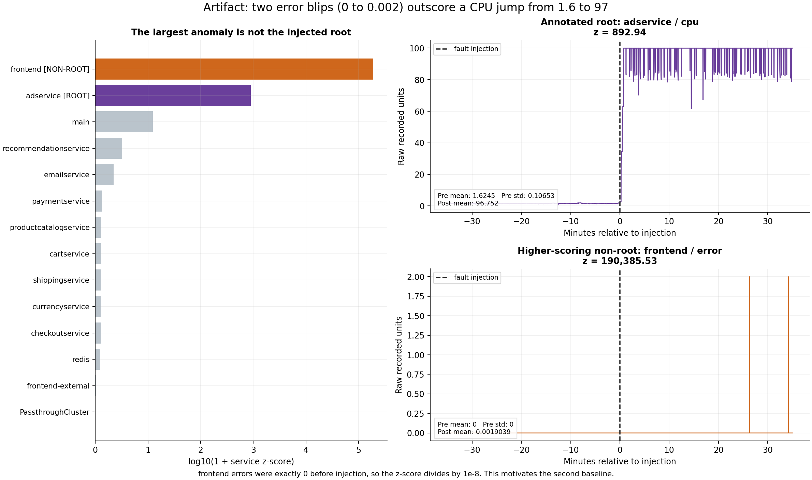

# Root cause localization for microservice failures

Given measurements collected during an incident, rank the service/candidate
most likely to be the annotated root cause. This university progress-review
project establishes a reproducible dataset audit and **two evaluated heuristic
baselines**, plus a **supervised Random Forest evaluated with scenario-grouped cross-validation**. A temporal encoder and graph neural network remain future work.

## Current progress

- Downloaded **125 RE1-OB (Online Boutique) cases**, with 25 cases per
  fault type. Only this subset's metrics and injection times were downloaded.
- Downloaded data/index files: **31,866,704 bytes**
  (31.87 MB), excluding downloader cache metadata.
- **123 cases are evaluable**; two supplied recordings have
  invalid before/after windows. Their timestamps and raw files remain unchanged.
- The original two notebooks executed top to bottom: **7 code cells in EDA and
  5 in baseline, zero errors**, with saved outputs.
- Baseline 1 (`zscore`): AC@1 **49.60%**. Baseline 2
  (`zscore_nonconst`, ignores metrics that were constant before injection):
  AC@1 **76.00%**, on all 125 cases.
- Even with the stronger baseline, **28** evaluable cases have a
  non-root candidate scoring strictly higher than the annotated root
  (61 with constant metrics kept).

## Setup on Windows (Python 3.10+)

The completed run used Python 3.11.9. From this project folder in PowerShell:

```powershell
python -m venv .venv
.\.venv\Scripts\python.exe -m pip install -r requirements.txt
.\.venv\Scripts\python.exe -m rca.download
.\.venv\Scripts\python.exe -m rca.evaluate --method zscore
.\.venv\Scripts\python.exe -m rca.evaluate --method zscore_nonconst
.\.venv\Scripts\python.exe scripts/execute_notebooks.py
```

Activation is optional: using the environment's Python directly avoids
PowerShell activation-policy problems. If activated, the requested evaluation
command is simply `python -m rca.evaluate --method zscore`.

Direct dependencies are pinned in `requirements.txt`; `requirements-lock.txt`
also records all installed dependency versions for the verified environment.
No GPU is needed for this week's baseline.

## Download and provenance

The [official RCAEval README](https://github.com/phamquiluan/RCAEval) documents
the Hugging Face `snapshot_download` method. `python -m rca.download` downloads
the index from [phamquiluan/RCAEval](https://huggingface.co/datasets/phamquiluan/RCAEval),
selects `dataset == 'RE1-OB'`, and requests only each selected case's
`metrics.parquet` and `inject_time.txt` in `data/raw/`.

Revision: `afeacb11bcc94dadfd1c8f483ee4377b2b8b614e`. Every request explicitly uses `token=False`;
the cached machine token is neither changed nor deleted. The whole-benchmark
index is metadata, not a download of other cases' telemetry. Raw data is ignored
by Git. File hashes and byte counts are in [the manifest](results/dataset_manifest.json).

See [DATA_FORMAT.md](docs/DATA_FORMAT.md) for the actual schema, labels, missing
values, candidate names, fault counts, and invalid timestamps. If a future
download fails, stop and report the error; do not substitute invented data.

## Supervised stage: first trained model

Five-fold grouped cross-validation keeps all repetitions of each root-service /
fault-type scenario together. The fixed Random Forest receives 48 numeric
service-change features, excluding names and labels. Its scores are out-of-fold.

| method              |   n_cases | AC@1   | AC@3   | AC@5    | Avg@5   |
|:--------------------|----------:|:-------|:-------|:--------|:--------|
| Random Forest (OOF) |       123 | 91.87% | 95.93% | 99.19%  | 96.10%  |
| Original z-score    |       123 | 50.41% | 89.43% | 95.12%  | 82.11%  |
| Nonconstant z-score |       123 | 77.24% | 91.87% | 100.00% | 90.73%  |

Primary denominator: **123 evaluable incidents**. With invalid cases included as
misses, Random Forest AC@1 is **90.40%** over 125 cases.
This is exploratory within-application CV on already-explored data, not a pristine
final test. Fold AC@1 ranges from 68% to 100%; the model does not improve every
ranking metric. See the [full supervised report](docs/SUPERVISED_BASELINE.md),
[fixed protocol](docs/ML_PROTOCOL.md), and [executed third notebook](notebooks/03_supervised.ipynb).

```powershell
.\.venv\Scripts\python.exe -m rca.supervised
```


## Original heuristic results

All metrics are **service-level**, between 0 and 1, shown here as percentages.
For `all_cases`, unscorable recordings count as misses. The second row shows the
separate valid-recording denominator; no cases disappear silently.
`zscore` keeps all metrics; `zscore_nonconst` ignores constant-before-injection metrics.

| method          | evaluation_set   | fault_type   |   n_cases |   n_evaluable | AC@1   | AC@3   | AC@5    | Avg@5   |
|:----------------|:-----------------|:-------------|----------:|--------------:|:-------|:-------|:--------|:--------|
| zscore          | all_cases        | all          |       125 |           123 | 49.60% | 88.00% | 93.60%  | 80.80%  |
| zscore          | evaluable_only   | all          |       123 |           123 | 50.41% | 89.43% | 95.12%  | 82.11%  |
| zscore_nonconst | all_cases        | all          |       125 |           123 | 76.00% | 90.40% | 98.40%  | 89.28%  |
| zscore_nonconst | evaluable_only   | all          |       123 |           123 | 77.24% | 91.87% | 100.00% | 90.73%  |

By fault type, using all supplied cases (both methods):

| method          | evaluation_set   | fault_type   |   n_cases |   n_evaluable | AC@1   | AC@3    | AC@5    | Avg@5   |
|:----------------|:-----------------|:-------------|----------:|--------------:|:-------|:--------|:--------|:--------|
| zscore          | all_cases        | cpu          |        25 |            24 | 48.00% | 92.00%  | 96.00%  | 84.80%  |
| zscore_nonconst | all_cases        | cpu          |        25 |            24 | 76.00% | 96.00%  | 96.00%  | 91.20%  |
| zscore          | all_cases        | delay        |        25 |            25 | 48.00% | 96.00%  | 100.00% | 84.80%  |
| zscore_nonconst | all_cases        | delay        |        25 |            25 | 92.00% | 100.00% | 100.00% | 98.40%  |
| zscore          | all_cases        | disk         |        25 |            25 | 84.00% | 100.00% | 100.00% | 96.00%  |
| zscore_nonconst | all_cases        | disk         |        25 |            25 | 92.00% | 100.00% | 100.00% | 97.60%  |
| zscore          | all_cases        | loss         |        25 |            24 | 20.00% | 52.00%  | 72.00%  | 50.40%  |
| zscore_nonconst | all_cases        | loss         |        25 |            24 | 32.00% | 56.00%  | 96.00%  | 61.60%  |
| zscore          | all_cases        | mem          |        25 |            25 | 48.00% | 100.00% | 100.00% | 88.00%  |
| zscore_nonconst | all_cases        | mem          |        25 |            25 | 88.00% | 100.00% | 100.00% | 97.60%  |

Source tables: per-case rankings ([zscore](results/zscore_per_case.csv),
[zscore_nonconst](results/zscore_nonconst_per_case.csv)) and summaries
([zscore](results/zscore_summary.csv), [zscore_nonconst](results/zscore_nonconst_summary.csv)).
These are our full-record z-score results,
not a reproduction of published BARO scores or the paper's exact window protocol.



## What the baselines do

For each metric, compare all observations before injection with all observations
at or after injection:

```text
metric score = abs(mean_after - mean_before) / (sample_std_before + 1e-8)
service score = maximum metric score for that service
```

Order by descending score; resolve exact ties alphabetically.
`zscore_nonconst` applies the same rule but ignores any metric whose
pre-injection standard deviation is exactly zero, because there the denominator
is only 1e-8 and a tiny blip gets an enormous score. Every observed
prefix is a candidate, including infrastructure-like names. The candidate list
is not restricted to the five services known to appear as root labels.

Missing cells remain NaN; the mean and sample standard deviation use the
available observations within their own window. Metrics need at least two
normal and one anomalous observation. A service with no usable metrics stays
at the bottom. In `zscore`, constant normal metrics are retained, so the tiny
denominator amplifies small changes; `zscore_nonconst` exists to remove that.

**Known injection time is allowed**, matching the supplied RCA setting.
Root labels enter only after prediction for evaluation and example selection.
The ranker receives no fault label, case identifier, or root label.

**This is offline localization after an incident**, using the full available
post-injection recording. It does not yet detect an incident online or establish
causal propagation. The original heuristic experiment had no training split. The supervised stage above adds grouped train/test folds, but no cross-system generalization or deployment result. The
constant-metric rule was chosen after looking at failures on these same cases,
so its score is an analysis result, not a held-out test.

## Motivating example and failures

In `re1ob_productcatalogservice_loss_3`, packet loss was injected into
`productcatalogservice`. With constant metrics ignored, its winning
`latency-50` score is 14.99, while its
caller `checkoutservice` scores 171.58 on
`latency-90`, about 11x higher. In Online
Boutique, `checkoutservice` calls `productcatalogservice`, so propagation is a
plausible explanation; the plot does not prove it. This example was hand-picked
from the 28 non-root wins as the clearest dependency to explain.



Why baseline 1 needed fixing: in `re1ob_adservice_cpu_3`, `frontend`
`error` went from exactly 0 to a mean of
0.0019 and scored 190,386,
beating the injected root's `cpu` jump from
1.6 to 96.8
(score 893).



Under `zscore_nonconst`, the first two worst ranked evaluable cases are `re1ob_checkoutservice_loss_1`
(root rank 5) and `re1ob_checkoutservice_loss_5`
(rank 5). Read the measured score tables and
qualified interpretations in [failure_analysis.md](docs/failure_analysis.md).

Two supplied cases cannot be ranked: `re1ob_currencyservice_loss_1` has zero
pre-injection rows, and `re1ob_productcatalogservice_cpu_3` has zero
post-injection rows. They have `status=invalid_window`, empty predictions, and
infinity root rank in the CSV. That infinity is a reporting sentinel, not a
model-produced rank. No timestamp correction was guessed.

## Notebooks and review material

- [01_eda.ipynb](notebooks/01_eda.ipynb): actual data audit, a root/comparison
  metric plot, search for a louder non-root, and the zero-variance artifact.
- [02_baseline.ipynb](notebooks/02_baseline.ipynb): evaluates both baselines,
  displays both denominator policies, compares them, and explains two failures.
- Read-only rendered copies: [EDA](results/01_eda.html) and
  [baseline](results/02_baseline.html). These include executed outputs.
- [03_supervised.ipynb](notebooks/03_supervised.ipynb): 48 features, grouped splits, trained Random Forest, comparisons and failures. [Rendered copy](results/03_supervised.html).
- [Eight-slide outline](docs/slide_outline.md), [related work](docs/related_work.md),
  and [execution record](results/notebook_execution.json).

To edit interactively using the project environment:

```powershell
.\.venv\Scripts\python.exe -m ipykernel install --sys-prefix --name rca-project --display-name "Python (RCA project)"
.\.venv\Scripts\python.exe -m jupyter lab
```

Select **Python (RCA project)**. The execution script instead creates a local
kernel specification inside `.jupyter/` and uses the same Python that launches
the script. It preserves executed notebooks and exports HTML automatically.
Notebook execution requires permission for the kernel's local communication
sockets. No application server or distributed infrastructure is started.

After editing analysis code, rerun evaluation and the notebooks. If changing
the pinned baseline's failure explanations, refresh `docs/failure_analysis.md`
from `rca.analysis.worst_case_explanation`, then regenerate notebooks with
`scripts/create_notebooks.py`. This clears prior notebook outputs; execute
them again. Finally run `scripts/build_reports.py` to refresh the README and
slide numbers from CSVs.

## Checks and what was skipped

```powershell
.\.venv\Scripts\python.exe -m unittest discover -s tests -v
.\.venv\Scripts\python.exe -m pip check
```

Thirteen focused tests check the score formula, injection boundary, missing-value
handling, deterministic ties, invalid windows, metric denominators, and that
`zscore_nonconst` ignores constant metrics. New tests also cover feature semantics, identity independence, and disjoint scenario folds.
Constructed test fixtures are not presented as benchmark recordings.

The first download attempt failed with an expired cached OAuth token. Retrying
with `token=False` succeeded; **Zenodo fallback was not needed**. An initial
notebook launch stalled under restricted local-kernel permissions; execution
with local-kernel permission succeeded for both notebooks.

**BARO was skipped before installation.** Official RCAEval 1.8.1 default-extra
metadata requires NumPy <2 on Python 3.11 and ipykernel 6.23.1, conflicting with
this pinned environment. We did not downgrade it or claim a BARO result. See
[recorded package constraints](results/optional_baro_check.json).

Docker, Kubernetes, new fault injection, a dependency graph, and GNN training
remain deliberately not set up. Existing raw files were not modified.

## Next steps

1. Try robust scaling (median/MAD) and other aggregations as stronger statistical baselines.
2. Completed: scenario-grouped five-fold splits and a fixed Random Forest baseline. Reserve genuinely new data for the next evaluation; do not retune to these CV results.
3. Learn an anomaly encoder and compare it with a simple learned service ranker.
4. Verify application dependency topology, then test a GNN against an otherwise
   identical model without graph edges. Do not assume graph learning is causal.
5. Later collect controlled fault-injection telemetry and reserve another whole
   application for cross-system evaluation. These steps are proposed, not run.

## Citation

Luan Pham, Hongyu Zhang, Huong Ha, Flora Salim, and Xiuzhen Zhang. 2025.
[RCAEval: A Benchmark for Root Cause Analysis of Microservice Systems with Telemetry Data](https://doi.org/10.1145/3701716.3715290).
Companion Proceedings of the ACM Web Conference 2025. The upstream dataset
is MIT licensed; our experiment is independently implemented.

## Supervised verification

All 3 notebooks have saved executed outputs. The supervised split records 25 scenario groups and 1649 candidate rows. The verification script checks fold isolation, source/data hashes, candidate scores and saved rankings, and reproduces the forests.
