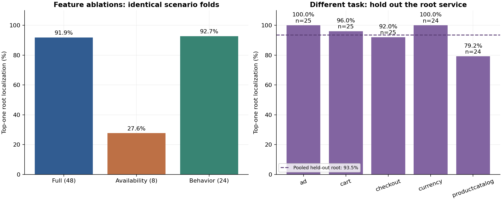

# Feature and root-service robustness audit

The existing scenario-CV result is **91.87%** top-one.
With availability alone it is **27.64%**;
with behavior features alone, **92.68%**.
The separate held-out-root-service task gives
**93.50%** top-one. All use the same fixed Random
Forest settings; no tuning or winner selection was performed.

## Why this experiment is necessary

A forest can learn relationships in measured changes, but it can also exploit
which measurements are available for a service. The previous folds held out
root/fault combinations while allowing the same root service in other training
scenarios. This audit probes both issues before increasing model complexity.
See the [pre-run protocol](ROBUSTNESS_PROTOCOL.md).

## Measured results

Primary denominator: **123 evaluable incidents**. The first three rows share the
exact original scenario folds. The last row changes the training partition and
answers a different generalization question.

| Experiment                              |   Incidents | AC@1   | AC@3   | AC@5    | Avg@5   |
|:----------------------------------------|------------:|:-------|:-------|:--------|:--------|
| Full features / scenario CV (reference) |         123 | 91.87% | 95.93% | 99.19%  | 96.10%  |
| Availability only / same scenario CV    |         123 | 27.64% | 63.41% | 75.61%  | 58.05%  |
| Behavior only / same scenario CV        |         123 | 92.68% | 95.12% | 99.19%  | 95.61%  |
| Full features / held-out root service   |         123 | 93.50% | 97.56% | 100.00% | 97.24%  |

A uniformly random first-ranked candidate would have expected AC@1
**7.47%**, calculated as the average of 1 / candidate count over
these incidents. This is an analytical reference, not a trained or sampled model.



All **125 supplied incidents**, counting the two invalid windows as misses:

| Experiment                              |   Incidents | AC@1   | AC@3   | AC@5   | Avg@5   |
|:----------------------------------------|------------:|:-------|:-------|:-------|:--------|
| Full features / scenario CV (reference) |         125 | 90.40% | 94.40% | 97.60% | 94.56%  |
| Availability only / same scenario CV    |         125 | 27.20% | 62.40% | 74.40% | 57.12%  |
| Behavior only / same scenario CV        |         125 | 91.20% | 93.60% | 97.60% | 94.08%  |
| Full features / held-out root service   |         125 | 92.00% | 96.00% | 98.40% | 95.68%  |

### Every held-out root service

| held_out_root         |   n_cases | AC@1    | AC@3    | AC@5    |
|:----------------------|----------:|:--------|:--------|:--------|
| adservice             |        25 | 100.00% | 100.00% | 100.00% |
| cartservice           |        25 | 96.00%  | 100.00% | 100.00% |
| checkoutservice       |        25 | 92.00%  | 100.00% | 100.00% |
| currencyservice       |        24 | 100.00% | 100.00% | 100.00% |
| productcatalogservice |        24 | 79.17%  | 87.50%  | 100.00% |

All fault families and repetitions rooted at the named service are absent from
that fold's training incidents. The service can still appear as a negative
candidate in those training incidents. This is not a wholly unseen service or
application test. Pool incident ranks for the main score; do not silently average
the five percentages with their slightly different denominators.

### Paired changes from the original forest

| Experiment                            |   Top-one gains vs reference |   Top-one losses vs reference |
|:--------------------------------------|-----------------------------:|------------------------------:|
| Availability only / same scenario CV  |                            1 |                            80 |
| Behavior only / same scenario CV      |                            1 |                             0 |
| Full features / held-out root service |                            3 |                             1 |

The held-out-root comparison changes the train/test task; its gains and losses
are descriptive and do not isolate a feature effect. Full failures and every
candidate score are saved in `results/robustness/`.

## Interpretation and limits

Availability patterns contain useful information, but availability alone does
not reproduce the full forest's performance. Removing the explicit flags changes
top-one success by 1 incident
(114 versus 113), while AC@3 and Avg@5 fall;
there is no consistent improvement across ranking cutoffs. We retain the original
baseline rather than select a new winner from these diagnostics.

The held-out-root experiment has 8 top-one misses, distributed
by fault as `{'loss': 8}`. Productcatalogservice is weakest at
79.17%
versus 93.50% pooled across all services.
Inspect the individual failures before interpreting the
high pooled score. Neither split is guaranteed to be empirically harder: each
holds out a different type of information and changes which training cases remain.

- Availability-only performance measures predictive information in availability
  patterns, including finite-observation requirements. It does not prove direct
  label leakage, service-name access, or causality.
- Removing explicit flags does not remove every schema clue. Behavior features
  still have named metric types and use zero for missing metrics.
- The held-out-root result measures transfer to a new fault location within
  Online Boutique. It does not test a new workload, fault family, or system.
- These data were already explored. These are diagnostic results, not a new
  untouched final test. No confidence intervals or statistical-significance
  claims are made; the incidents are dependent repetitions of only 25 scenarios.
- All experiments use complete before/after recordings and supplied injection
  times. Early detection and performance under short observation windows remain
  untested. Both invalid recordings remain unmodified.

## Evidence and reproduction

The manifest records 3 fixed new variants and 15 new
forests, explicit case splits, full feature lists, input/source hashes and
scikit-learn 1.5.2. Text hashes normalize CRLF to LF so
Windows notebook outputs and Git's LF files verify identically after a clone.
The reference scores are copied from
the original experiment without replacement. Verification independently refits
the new forests and recalculates the saved scores, rankings and summaries.

```powershell
.\.venv\Scripts\python.exe scripts/execute_notebooks.py 04_robustness.ipynb
.\.venv\Scripts\python.exe scripts/build_reports.py
.\.venv\Scripts\python.exe scripts/verify_project.py
```

The [executed fourth notebook](../notebooks/04_robustness.ipynb) reruns the complete
audit. Its [rendered HTML](../results/04_robustness.html) retains outputs.
Alternatively run `python -m rca.robustness` followed by
`python -c "from rca.robustness_report import build_report; build_report()"`.

Next: reserve new data and specify its evaluation protocol before further model
selection. Add a robust statistical baseline and a fixed observation-window
study before interpreting gains from a temporal or graph model.
