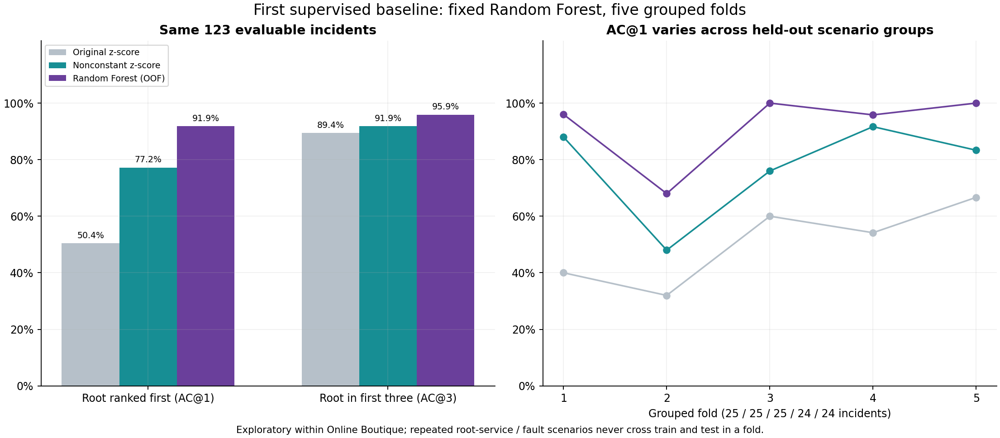

# First supervised baseline: Random Forest

## What changed

The project now trains a supervised Random Forest to score a candidate service
as root versus non-root, then ranks each incident's candidates. This is the first
trained model; the two existing methods remain statistical references.

The [fixed protocol](ML_PROTOCOL.md) specifies features, model parameters, and
evaluation before the first fit. There was no parameter search or seed selection.

## Data and features

- 125 supplied incidents; 123 have valid windows.
- 25 root-service / fault-type scenario groups, keeping repetitions together.
- 1649 candidate-service rows; these are not independent incidents.
- 48 numeric features: six changes/availability indicators for each of eight metric types.
- Service names, fault labels, filenames, timestamps, case IDs, and root labels are not model features.
- Class imbalance is handled using balanced_subsample class weights; no synthetic resampling.

Each feature row is computed independently from its own incident's pre/post
windows. Available metric types can still act as proxies for service roles.
The full post-injection recording and supplied injection time remain assumptions.

## Split and training

Five-fold GroupKFold holds each evaluable incident out exactly once. Each fold
trains on 98 or 99 incidents and tests on 24 or 25. A root/fault scenario and all
its repetitions stay wholly on one side of that fold's boundary. Group metadata
is used for splitting only, never as an input feature.

Each forest has 300 trees, maximum depth 6, minimum leaf size 3, sqrt feature
sampling, balanced_subsample weights, seed 42, and one worker. Trees are trained
on numeric features from training incidents only. Class-1 predict_proba values
are uncalibrated ranking scores, not verified confidence probabilities.

The [split manifest](../results/supervised/split_manifest.json) was saved before
fitting; it records every training/test incident, group, configuration, and source
hash. No final all-data model is used for the reported scores.

## Primary comparison: 123 evaluable incidents

| method              |   n_cases | AC@1   | AC@3   | AC@5    | Avg@5   |
|:--------------------|----------:|:-------|:-------|:--------|:--------|
| Random Forest (OOF) |       123 | 91.87% | 95.93% | 99.19%  | 96.10%  |
| Original z-score    |       123 | 50.41% | 89.43% | 95.12%  | 82.11%  |
| Nonconstant z-score |       123 | 77.24% | 91.87% | 100.00% | 90.73%  |

Random Forest places the root first in **113/123 incidents**.
It gets 19 previously missed top-one cases right and loses 1 that the
nonconstant heuristic got right. Its AC@5 is slightly below that heuristic;
the learned model does not improve every metric.



With all 125 supplied incidents in the denominator and invalid recordings counted
as misses, Random Forest achieves AC@1 **90.40%**, AC@3
**94.40%**, AC@5 **97.60%**, and Avg@5
**94.56%**. The invalid cases were neither trained on nor predicted.

## Fold variability

|   fold |   n_cases | AC@1    | AC@3    | Avg@5   |
|-------:|----------:|:--------|:--------|:--------|
|      1 |        25 | 96.00%  | 100.00% | 99.20%  |
|      2 |        25 | 68.00%  | 80.00%  | 82.40%  |
|      3 |        25 | 100.00% | 100.00% | 100.00% |
|      4 |        24 | 95.83%  | 100.00% | 99.17%  |
|      5 |        24 | 100.00% | 100.00% | 100.00% |

The lowest fold AC@1 is **68.00%**, versus a highest of
**100.00%**. The pooled score hides meaningful scenario variation.
Folds are different scenario collections, not interchangeable repeated trials.

## By fault type, evaluable incidents only

| fault_type   |   n_cases | AC@1    | AC@3    | AC@5    | Avg@5   |
|:-------------|----------:|:--------|:--------|:--------|:--------|
| cpu          |        24 | 100.00% | 100.00% | 100.00% | 100.00% |
| delay        |        25 | 92.00%  | 100.00% | 100.00% | 98.40%  |
| disk         |        25 | 100.00% | 100.00% | 100.00% | 100.00% |
| loss         |        24 | 66.67%  | 79.17%  | 95.83%  | 81.67%  |
| mem          |        25 | 100.00% | 100.00% | 100.00% | 100.00% |

## Remaining Random Forest failures

| case_id                             | fault_type   |   fold | true_root             |   rank_of_true_root |
|:------------------------------------|:-------------|-------:|:----------------------|--------------------:|
| re1ob_productcatalogservice_loss_4  | loss         |      2 | productcatalogservice |                   6 |
| re1ob_productcatalogservice_loss_2  | loss         |      2 | productcatalogservice |                   5 |
| re1ob_productcatalogservice_loss_1  | loss         |      2 | productcatalogservice |                   4 |
| re1ob_productcatalogservice_loss_3  | loss         |      2 | productcatalogservice |                   4 |
| re1ob_productcatalogservice_loss_5  | loss         |      2 | productcatalogservice |                   4 |
| re1ob_checkoutservice_loss_1        | loss         |      2 | checkoutservice       |                   3 |
| re1ob_cartservice_loss_4            | loss         |      2 | cartservice           |                   2 |
| re1ob_checkoutservice_loss_2        | loss         |      2 | checkoutservice       |                   2 |
| re1ob_currencyservice_delay_4       | delay        |      1 | currencyservice       |                   2 |
| re1ob_productcatalogservice_delay_5 | delay        |      4 | productcatalogservice |                   2 |

These are held-out prediction failures, not training-set errors. Refer to the
per-candidate scores and full rankings before proposing a mechanism. Impurity
importance in `feature_importance.csv` describes the fitted forests; it does not
establish causation or prove generalization.

## What this does and does not establish

The fixed learned model improved top-one ranking on this grouped experiment.
However, RE1-OB was previously explored while constructing the heuristics.
This is exploratory cross-validation within one application, not a pristine
untouched test or cross-system result. There are only 25 scenario groups.
Schema/availability patterns and recording regimes may act as shortcuts even
without service names. No causal, online-detection, production, or GNN claim is made.

Next: evaluate sensitivity to features and recording regimes, add a robust
statistical baseline, and reserve genuinely new data before further model
selection. Verify dependency topology before introducing a graph model.

## Reproduce

```powershell
.\.venv\Scripts\python.exe -m rca.supervised
.\.venv\Scripts\python.exe scripts/execute_notebooks.py 03_supervised.ipynb
.\.venv\Scripts\python.exe scripts/build_reports.py
.\.venv\Scripts\python.exe scripts/verify_project.py
```

The executed [third notebook](../notebooks/03_supervised.ipynb) explains features,
fold isolation, training, results, importance, and failures. It reruns the complete
fixed experiment. See `results/supervised/` for the CSVs and provenance.
